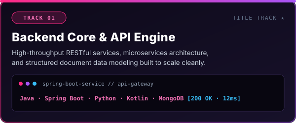
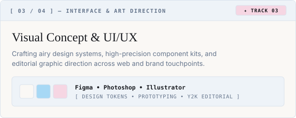

  
  
  
  
  

I build **backend services**, choreograph **automated workflows with n8n**, and craft **airy, high-precision interfaces**. Most of what I make is designed to run quietly and reliably on your own infrastructure: **clean APIs, self-hosted pipelines, and lucid visual systems**. By day I architect backend logic with **Java (Spring Boot)**, **Python**, and **MongoDB**; across operations I replace repetitive manual work with autonomous **n8n** flows while shaping product aesthetics in **Figma** and the **Adobe Creative Suite**.

## <samp>✦ [ 01 ]</samp> What I'm building

  
  

  
  

<samp>[ INDEX ]</samp> <a href="https://github.com/NgManh2509?tab=repositories">Spring Boot APIs</a> • <a href="https://n8n.io">n8n Orchestration</a> • <a href="https://github.com/NgManh2509?tab=repositories">Figma UI Systems</a> • <a href="https://github.com/NgManh2509?tab=repositories">Docker Pipelines</a> • live repos in the pins below

## <samp>✦ [ 02 ]</samp> Architecture, Automation & Visual Direction

Software products lose their clarity when backend engineering, operational workflows, and visual design live in separate worlds. I bridge all three as one continuous system — designing the interface concept, building the backend services behind it, and wiring the **n8n** automation flows that keep data moving without manual intervention.

> [!IMPORTANT]
> **Precision & Restraint.** An automation flow or backend service isn't just code that runs once — it's an operational rhythm. If a webhook drops or a payload drifts, the pipeline stalls. The standard is clean boundaries, zero-touch reliability, and a calm interface that never feels cluttered.

**What I build and run**

<table>
  <tr>
    <td width="33%" valign="top"><samp><b>[01]</b></samp> <b>Backend engines</b> RESTful APIs and service logic built with Java, Spring Boot, Python, and Kotlin.</td>
    <td width="33%" valign="top"><samp><b>[02]</b></samp> <b>n8n flow choreography</b> Multi-step webhook automations, scheduled jobs, and third-party API integrations.</td>
    <td width="33%" valign="top"><samp><b>[03]</b></samp> <b>Document & data pipelines</b> MongoDB schemas, data ingestion, transformation, and automated sync flows.</td>
  </tr>
  <tr>
    <td width="33%" valign="top"><samp><b>[04]</b></samp> <b>UI/UX & art direction</b> Airy interface systems in Figma paired with visual assets in Photoshop & Illustrator.</td>
    <td width="33%" valign="top"><samp><b>[05]</b></samp> <b>Responsive web interfaces</b> Crisp HTML5, CSS3, and JavaScript frontends faithful to typography and spacing.</td>
    <td width="33%" valign="top"><samp><b>[06]</b></samp> <b>Containers & CI/CD</b> Dockerized services and GitHub Actions workflows for repeatable deployments.</td>
  </tr>
</table>

## <samp>✦ [ 03 ]</samp> Toolkit & Stack

  

Plus **n8n**, Webhook Orchestration, RESTful API Design, GitHub Actions, and Editorial UI Design Systems.

  
<samp><b>✦ [ NOTES ] How I like to work</b></samp>

   

- **Automate the repetitive beat** — If an operation has to be done by hand twice, it belongs in an **n8n** workflow or a scheduled pipeline.
- **Airy clarity over noise** — Whether in an API schema or a UI layout, remove anything that doesn't earn its place.
- **Design and engineering in one frame** — Interface concepts shouldn't lose their restraint when translated to code.
- **Own the stack** — Self-hosted Docker services, transparent webhook logs, and workflows you fully control.

## <samp>✦ [ 04 ]</samp> GitHub Statistics & Activity

  
  
  

 

  <picture>
    <source media="(prefers-color-scheme: dark)" srcset="https://raw.githubusercontent.com/NgManh2509/NgManh2509/output/github-contribution-grid-snake-dark.svg" />
    <source media="(prefers-color-scheme: light)" srcset="https://raw.githubusercontent.com/NgManh2509/NgManh2509/output/github-contribution-grid-snake.svg" />
    
  </picture>
    
  

---

<samp>✦</samp> <b>Building something with backend systems, automated flows, or airy visual design?</b> <a href="mailto:mxnhedit1234@gmail.com">Write to me</a> <samp>[ ↗ ]</samp>

