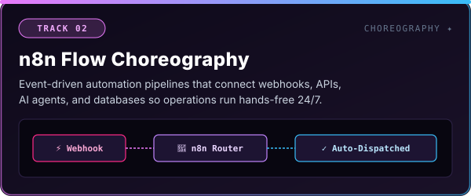
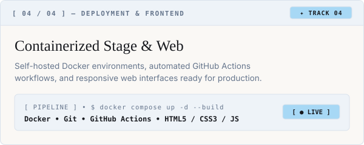
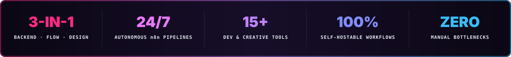

  
  
  
  
  

I build **backend services**, choreograph **automated workflows with n8n**, and craft **high-impact visual interfaces**. Most of what I engineer is designed like a tightly produced K-pop stage: **every API call, webhook trigger, and pixel hits on cue**. By day I architect backend logic with **Java (Spring Boot)**, **Python**, and **MongoDB**. Across operations I replace repetitive manual tasks with autonomous **n8n** pipelines, while shaping product visuals with **Figma** and the **Adobe Creative Suite**.

## 💿 What I'm building

  
  

  
  

Core disciplines: <a href="https://github.com/NgManh2509?tab=repositories">Spring Boot APIs</a> · <a href="https://n8n.io">n8n Orchestration</a> · <a href="https://github.com/NgManh2509?tab=repositories">Figma UI Systems</a> · <a href="https://github.com/NgManh2509?tab=repositories">Docker Pipelines</a> · live repos in the pins below

## 🎤 On stage: Backend Producer & Automation Choreographer

Modern software products fail when backend engineering, operational workflows, and visual design operate in silos. I work across all three layers as a single integrated production unit — designing the visual concept, building the backend APIs that power it, and wiring the automation flows that keep the system running without manual intervention.

> [!IMPORTANT]
> **The Production Standard.** An automation flow or backend service isn't just code that compiles — it's a live stage performance. If a webhook drops or a data pipeline stalls, the whole workflow breaks rhythm. The goal is clean architecture, zero-touch reliability, and an interface people actually enjoy using.

**What I build and run**

<table>
  <tr>
    <td width="33%" valign="top"><b>⚙️ Backend engines</b> RESTful APIs and business logic built with Java, Spring Boot, Python, and Kotlin.</td>
    <td width="33%" valign="top"><b>🔄 n8n flow choreography</b> Multi-step webhook automations, scheduled jobs, and third-party API integrations.</td>
    <td width="33%" valign="top"><b>🗄️ Document & data pipelines</b> MongoDB schemas, data ingestion, transformation, and automated sync flows.</td>
  </tr>
  <tr>
    <td width="33%" valign="top"><b>🎨 UI/UX & visual direction</b> Interactive prototypes in Figma paired with brand graphics in Photoshop & Illustrator.</td>
    <td width="33%" valign="top"><b>🌐 Responsive web interfaces</b> Clean HTML5, CSS3, and JavaScript frontends that stay faithful to the design spec.</td>
    <td width="33%" valign="top"><b>🐳 Containers & CI/CD</b> Dockerized services and GitHub Actions workflows for repeatable deployments.</td>
  </tr>
</table>

## 🧰 Stack

  

Plus **n8n**, Webhook Orchestration, RESTful API Design, GitHub Actions, and Visual Design Systems.

  
<b>✨ How I like to work (Producer's Creed)</b>

   

- **Automate the repetitive beat.** If an operation has to be done by hand twice, it belongs in an **n8n** workflow or a scheduled script.
- **Design and engineering in one take.** UI/UX shouldn't lose its polish when handed off to code; building both keeps the visual rhythm intact.
- **Small, resilient services.** Clean APIs, explicit payloads, and self-contained Docker services beat monolithic guesswork.
- **Own the pipeline.** Self-hosted workflows, transparent logs, and systems that keep running reliably backstage.

  
<b>📊 Live Stage Telemetry & Contribution Snake</b>

   
  

    
    
    
      
    <picture>
      <source media="(prefers-color-scheme: dark)" srcset="https://raw.githubusercontent.com/NgManh2509/NgManh2509/output/github-contribution-grid-snake-dark.svg" />
      <source media="(prefers-color-scheme: light)" srcset="https://raw.githubusercontent.com/NgManh2509/NgManh2509/output/github-contribution-grid-snake.svg" />
      
    </picture>
      
    
  

---

<b>Building something with backend systems, automated flows, or high-impact visuals?</b> <a href="mailto:mxnhedit1234@gmail.com">Write to me.</a>

