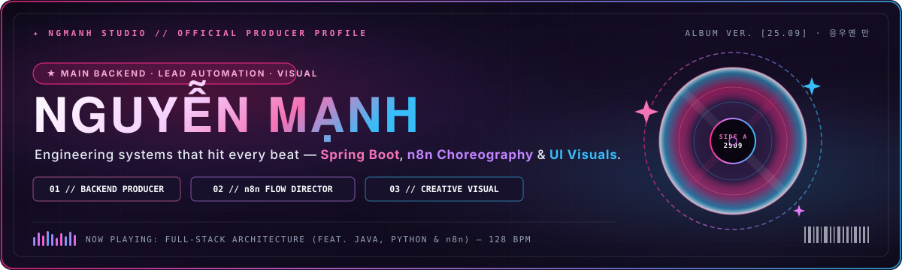

  
  
  

<samp>Backend • n8n Automation • UI/UX — quiet systems, lucid interfaces.</samp>

## <samp>✦ [ 01 ]</samp> Building

  
  

  
  

## <samp>✦ [ 02 ]</samp> Stack

  

## <samp>✦ [ 03 ]</samp> Stats

  
  
  
    
  <picture>
    <source media="(prefers-color-scheme: dark)" srcset="https://raw.githubusercontent.com/NgManh2509/NgManh2509/output/github-contribution-grid-snake-dark.svg" />
    <source media="(prefers-color-scheme: light)" srcset="https://raw.githubusercontent.com/NgManh2509/NgManh2509/output/github-contribution-grid-snake.svg" />
    
  </picture>
    
  

---

<samp>✦ <a href="mailto:mxnhedit1234@gmail.com">Write to me</a> [ ↗ ]</samp>

